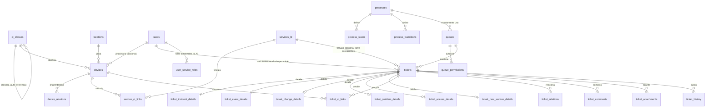

# MODELO — diagrama, diccionario y mapeo de fuentes (Parcial 3)

> El modelo de Parcial 2 (organización, catálogo de servicios) no cambia; su diagrama y diccionario están en
> `docs/RESOLUCION.md` §3. Este documento cubre **solo lo nuevo**: CMDB y Service Desk. Todas las tablas nuevas son
> aditivas — la migración `0002_service_desk_cmdb.py` no contiene ningún `ALTER TABLE` sobre el esquema de Parcial 2.

## 1. Diagrama entidad-relación



## 2. Diccionario — CMDB

| Tabla | Campos clave / restricciones |
|---|---|
| `ci_classes` | `code` UNIQUE, name, `parent_id` FK a sí misma (jerarquía, sin ciclos — validado en servidor), `requires_ip` (orientativo, nunca obliga), is_active |
| `locations` | `code` UNIQUE, name, is_active (catálogo plano) |
| `devices` | `asset_tag` UNIQUE, name, `ci_class_id` FK NOT NULL (debe ser clase hoja activa), status CHECK(activo/inactivo/retirado), `location_id`/`owner_user_id` FK NULL, `ip_address` **siempre NULL-able**, `serial_number` NULL, `attributes` JSON (según clase), `generator_seed` (trazabilidad del generador) |
| `device_relations` | `from_device_id`/`to_device_id` FK a `devices`, `relation_type` (`depende_de`/`alojado_en`: sin ciclos; `conectado_a`: con ciclos) |
| `service_ci_links` | PK compuesta (`service_l2_id`, `device_id`) |

## 3. Diccionario — Service Desk

| Tabla | Campos clave / restricciones |
|---|---|
| `processes` | `code` UNIQUE (7 filas fijas), name, `ticket_type` (mapeo a los 6 tipos de la diapo. 14) |
| `process_states` / `process_transitions` | Grafo 2: nodos (estado, `is_initial`/`is_final`) y aristas (`from_code`→`to_code` por `action`, `required_perm` opcional) por proceso |
| `queues` | `code` UNIQUE, `process_id` FK NOT NULL (una cola = un proceso), `support_level`, `ordering_rule` (`priority_then_age`), `targets` JSON (minutos objetivo por prioridad) |
| `queue_permissions` | `queue_id` FK, (`principal_role` XOR `principal_user_id`), `can_view/work/transfer/approve/manage` |
| `tickets` | `number` UNIQUE, title, description, `ticket_type`, `process_id`/`queue_id`/`service_l2_id` FK, `requester_user_id`/`creator_user_id`/`assignee_user_id` FK, `state`, `priority` CHECK(baja/media/alta), impact, urgency, channel, `resolved_at`/`closed_at` |
| `ticket_incident_details` | `category` CHECK(I0–I6), `estimated_minutes`/`actual_minutes`, `redundancy_available` |
| `ticket_event_details` | `category` CHECK(E0–E3), `linked_incident_id` FK a `tickets` (NULL hasta evaluar E2/E3) |
| `ticket_change_details` | `change_type` CHECK(estandar/normal/emergencia), risk_level, test_plan, rollback_plan, `approved_by_user_id`/`approved_at` |
| `ticket_problem_details` | root_cause, workaround, `known_error`, permanent_solution, `linked_change_id`/`linked_incident_id` FK a `tickets` |
| `ticket_access_details` | `beneficiary_user_id` FK NOT NULL, resource, permission_requested, `approver_user_id`/`approved_at` |
| `ticket_new_service_details` | proposed_name, `proposed_level1_id` FK, `created_service_l2_id` FK (se completa al aprobar) |
| `ticket_ci_links` / `ticket_relations` | vínculos N:N ticket↔CI y ticket↔ticket (con `relation_type`) |
| `ticket_comments` | visibility CHECK(publico/interno) |
| `ticket_attachments` | content_type, size_bytes, storage_path (validados en `app/ticket_engine.py`) |
| `ticket_history` | append-only: actor, acción, campo, valor anterior/nuevo, fecha — nunca se borra ni se actualiza |
| `user_service_roles` | PK compuesta (`user_id`, `role_code` CHECK(solicitante/agente/aprobador)) — aditivo sobre `users.role` |

## 4. Jerarquía de clasificación de CI y mapeo de fuentes
Ver `docs/contexto/05-cmdb-jerarquia.md` para la justificación completa (por qué es una decisión de proyecto y no una
transcripción literal de una fuente). Resumen del árbol sembrado por la migración 0002
(`app/reference_data.py::CI_CLASSES`):

```
Hardware (HW) *            Software (SW) *          Documentación (DOC)     Instalaciones (FAC)
├─ Servidor (HW.SRV)        ├─ Sistema operativo       ├─ Manual               ├─ Centro de datos
├─ Estación de trabajo        (SW.OS)                  └─ Procedimiento        └─ Sala de servidores
├─ Equipo de red (HW.NET)   ├─ Aplicación (SW.APP)
├─ Almacenamiento (HW.STO)  ├─ Base de datos (SW.DB)
└─ Periférico (HW.PER)      └─ Licencia (SW.LIC)
```
`*` = únicos valores verificados contra una fuente real (`CMDB.xlsx!C5:C6`, confirmados en `Transicion.pptx.pdf` p.11
como el modelo conceptual de campos). El resto de la subdivisión es una decisión de proyecto documentada.

| Campo de `devices` | Origen |
|---|---|
| `name`, `ci_class_id` (Tipo de CI) | `CMDB.xlsx!B4/C4` |
| `serial_number`, atributos de versión | `CMDB.xlsx!E4/F4`, `Transicion.pptx.pdf` p.11 |
| `status` | `CMDB.xlsx!H4` ("Estado Actual") |
| `device_relations` | `CMDB.xlsx!I4/J4` ("Relaciones"/"Padres-Hijos") — reinterpretado como grafo con tipos (§6 CMDB y §9 del enunciado piden distinguir jerarquía de clasificación de relaciones técnicas) |
| `location_id` | `CMDB.xlsx!K4` ("Ubicación Física") |
| `owner_user_id` | `CMDB.xlsx!L4` ("Propietario/Responsable") |
| Campos **no** incorporados como columnas propias (se dejan en `attributes` JSON si aplican, por clase): Niveles de Seguridad, Cumplimiento, Estado de Configuración, Número/Vencimiento de Licencia | `CMDB.xlsx!Q4-U4` — se consideran atributos técnicos dependientes de la clase, no universales (p. ej. "licencia" solo aplica a `SW.LIC`) |

## 5. Reglas de negocio nuevas (resumen; detalle operativo en `docs/PROCESOS.md`)
1. Un dispositivo solo puede crearse bajo una clase **hoja** (sin subclases activas).
2. `ip_address` nunca es obligatoria, ni siquiera en clases con `requires_ip = True`.
3. La jerarquía de clasificación y las relaciones `depende_de`/`alojado_en` no admiten ciclos; `conectado_a` sí.
4. `service_l2_id` es obligatorio en el ticket salvo en `accesos` (el recurso puede no ser un servicio del catálogo) y
   `nuevos_servicios` (el servicio todavía no existe).
5. Toda transición de ticket debe ser una arista explícita de `process_transitions`; el permiso exigido (`required_perm`,
   o `work` por defecto) se evalúa contra la cola actual del ticket, salvo `admin` (control total) y `reabrir` desde el
   propio solicitante sobre su ticket.
